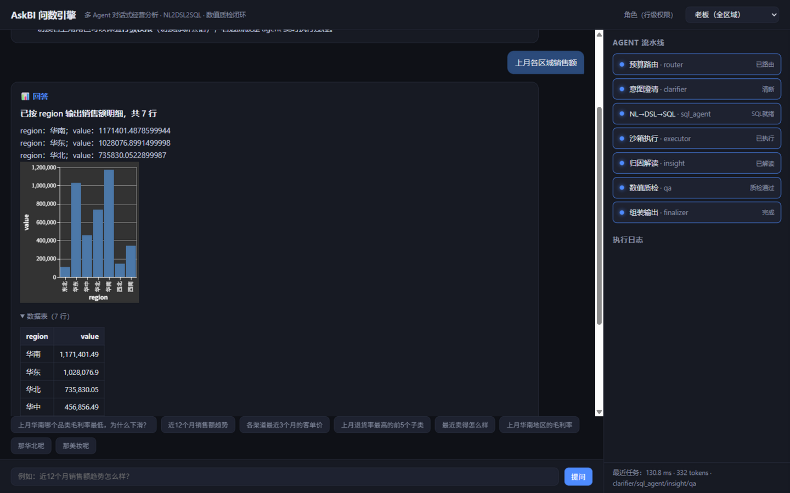
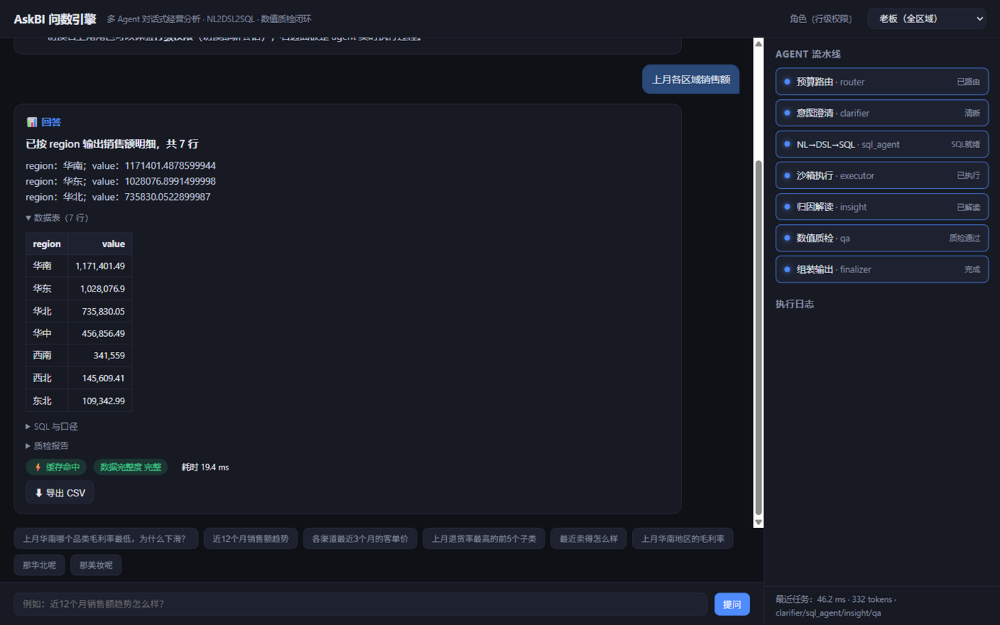
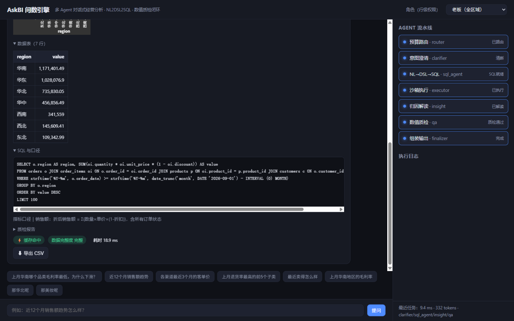
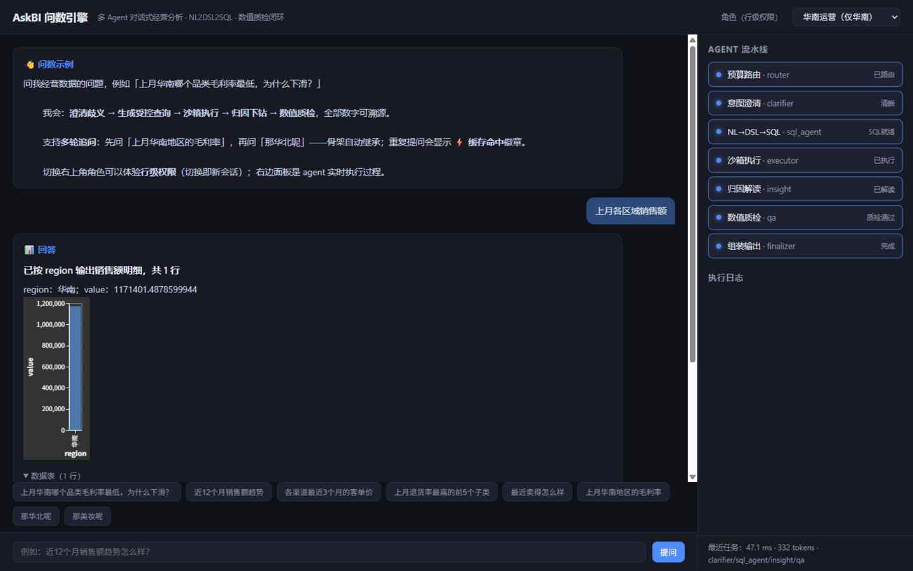
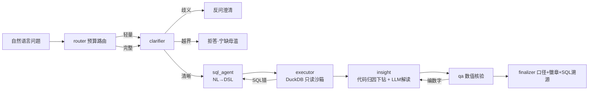

# AskBI 问数引擎

> 对标腾讯云 ChatBI / 阿里瓴羊智能小Q 的多 Agent 对话式经营分析系统
> **NL2DSL2SQL 受控查询 · 数值确定性 · 合规质检闭环 · 可判对错的评测**

[]() []() []() []() []()

> **面试者/评审请从 [EVIDENCE.md](EVIDENCE.md) 开始**——做了什么/没做什么、三个真实 bug、分层评测表、逐条复现命令。

## 界面速览

| 首答：Vega 图表 + 数据表 | 复问命中：⚡ 缓存徽章 + 一键导出 |
|---|---|
|  |  |

| SQL 与口径逐字溯源 | 行级权限：老板 7 行 / 华南 1 行 / 北方 2 行 |
|---|---|
|  |  |

答案卡自带「⬇ 导出 CSV」：优先 `/api/export?task_id=` 服务端导出（RFC 5987 中文文件名），失败自动降级前端生成——同一格式：UTF-8 BOM + 元信息段 + SQL 口径 + 数据表，Excel 双击直开；`app/export.py` 标准库 csv 零依赖实现，9 项单测（注入转义 roundtrip + API 集成）。URL 深链 `?q=<问题>&role=<boss|south|north>` 可直达任意演示帧。完整截图（含首页与北方区 2 行对比）在 [docs/screenshots/](docs/screenshots/)。

## 这是什么

中小电商公司没有数据团队，老板/运营想问：**"上月华南哪个品类毛利率最低，为什么下滑？"**
AskBI 用一组协作的 Agent 把这个问题变成一份**数字全部可溯源、过完质检**的分析答案：



**六个设计主张**（每个都能在 [docs/DESIGN.md](docs/DESIGN.md) 找到为什么）：

| # | 设计 | 一句话 |
|---|---|---|
| 1 | **NL2DSL2SQL** | LLM 只产受白名单约束的结构化意图，SQL 由编译器渲染——注入和幻觉表名在编译期不可达 |
| 2 | **数值确定性 + 质检闭环** | 报告里的每个数字都来自 SQL 结果集，QA Agent 逐个核验，编造数字会被打回重写 |
| 3 | **口径治理** | 指标字典给"毛利率"唯一权威表达式+版本化口径说明，答案自带口径 |
| 4 | **安全沙箱** | 只读连接 + 语句守卫 + 行级权限（角色切换演示）+ LIMIT 强制 |
| 5 | **歧义澄清 + 拒答** | 模糊问题反问而不是瞎猜；数据没有/要预测未来 → 明确拒答 |
| 6 | **Eval 即 CI** | smoke 33 条回归集 + full 116 条分层集（含 15 条 holdout）+ 多轮 30 条，mock/real 双口径 + 消融开关 + 故障注入 |

## 快速开始

```bash
# 1) 安装（建议虚拟环境）
pip install -r requirements.txt

# 2) 生成演示数据（DuckDB 单文件，24 个月，~20 万行订单明细，固定种子）
python scripts/gen_data.py

# 3a) 命令行演示（mock 模式，无需任何 API key）
python scripts/demo.py

# 3b) 或启动 Web 工作台
python -m uvicorn app.api.main:app --port 8000
# 打开 http://127.0.0.1:8000 —— 输入问题，右侧看 Agent 流水线实时执行
```

**接入真实模型**（DeepSeek / GLM / 任意 OpenAI 兼容）：

```bash
cp .env.example .env
# 编辑 .env：LLM_PROVIDER=deepseek  DEEPSEEK_API_KEY=sk-...
python -m uvicorn app.api.main:app --port 8000
```

**Docker 一键启动**（内置 mock 模式 + 演示数据）：

```bash
docker compose up --build          # http://localhost:8000
LLM_PROVIDER=deepseek DEEPSEEK_API_KEY=sk-... docker compose up
```

## 评测（分层口径：回归集 ≠ benchmark）

```bash
python scripts/run_eval.py                                          # v1 smoke 回归集 33 条
python scripts/run_eval.py --dataset eval/dataset_v2.json           # v2 full 分层集 116 条
python scripts/run_eval.py --dataset eval/dataset_v2.json --split holdout   # 仅 holdout 15 条
python scripts/run_eval.py --ablation sloppy                        # 模拟"LLM 编数字"，验证 QA 闭环拦截
python scripts/run_eval.py --ablation no_qa                         # 关闭修订循环
python scripts/build_dataset_v2.py --check                          # 金标自检（可重建评测集）
python scripts/run_multiturn_eval.py                                # 多轮 30 条 64 轮
python scripts/fault_inject.py --n 10                               # 故障注入 6 场景
python scripts/load_test.py                                         # 压测矩阵 12 点位
```

v2 分层集：80 query / 12 归因 / 12 澄清 / 12 拒答，**金标一律由 `compile_sql` 生成**（`scripts/build_dataset_v2.py` 构建期自检：mock 解析器重答每道 query 题与金标同库比对），含行级权限 role 用例与"净销售额"口径题。真实模型口径（deepseek-v4-flash，2026-10-29）：全量 **94.8%**、拒答边界校准后子集全绿、holdout 盲测两轮 84.6%/100%（汇总见 [eval/report_openai_compatible_dataset_v2.md](eval/report_openai_compatible_dataset_v2.md)）。v1 33 条保留为 smoke 回归集——**"33 条是回归集，不是 benchmark"是有意的工程判断**。

**真实模型结果**（deepseek-v4-flash-0731 @ DashScope 兼容接口）：v1 33 条 2026-10-26（下表）；v2 116 条 2026-10-29（`eval/report_openai_compatible_dataset_v2.md`）。

| 指标 | 结果 |
|---|---|
| 端到端准确率（33 条） | **100%**（query 24/24 · 拒答 4/4 · 澄清 3/3 · 归因 2/2） |
| 叙述数值一致率 | **100%** |
| 消融：关闭 QA 修订循环 | 准确率 **93.9%**、数值一致率 **90.9%** → 质检闭环修回 2 条归因题 |
| 评测成本 | ~15.1 万 token/遍（<¥0.5） |

**流水线验证**（mock 确定性模式，无 API key 可复现）：

| 指标 | 结果 |
|---|---|
| 执行准确率（24 条 query，结果集与 gold SQL 逐行比对） | **24/24** |
| 拒答正确率（预测类/不存在指标/未知取值） | **4/4** |
| 澄清正确率（指标模糊） | **3/3** |
| 归因完整率（叙述+维度分解+数值核验通过） | **2/2** |
| 消融：sloppy（注入编造数字） | QA 修订循环 **2/2 拦截**，最终带失败徽章降级输出 |

> 评测迭代过程（87.9% → 97.0% → 100%，每轮由评测集定位问题、修 prompt/判定、回归）见 [docs/RESUME.md](docs/RESUME.md)。

**Eval 即 CI**：仓库自带 [`.github/workflows/ci.yml`](.github/workflows/ci.yml)——推送到 GitHub 后，每次 push 自动执行「装依赖 → 生成数据 → 全量测试 → smoke + full 双评测集」流程（mock 模式，无需任何 secret），评测报告作为 artifact 留档。

## 可靠性证据（demo 只测 happy path，工程系统测失败路径）

- **故障注入**（`evidence/fault_injection.md`）：LLM 瞬时故障/完全不可用/返回非法 JSON/SQL 超时/库文件缺失/编造指标，6 场景 ×10 次——**零崩溃**，全部诚实降级（拒答/留空叙述/回退确定性核验），客户端指数退避 + 节点降级语义 + SQL 修复循环 + 白名单守卫四层吸收。
- **压测**（`evidence/load_test.md`）：进程内 12 点位矩阵（并发 10/25/50 × 缓存开关 × 模拟 LLM 延迟 0/300ms）。结论：编排上限 110-124 QPS；P95 ≈ 单请求 LLM 串行调用次数 × 单次延迟（light 2 次/full 4 次），**瓶颈在 LLM 不在检索/SQL**；压测还揪出并修复了缓存负收益真 bug（版本探测每 get 全表扫描 → 30s 记忆化，修复后 +12%）。
- **功能档位**：`PROFILE=conservative`（默认，实验功能全关零行为变化）/ `PROFILE=full`（一键演示）。`python scripts/demo_full.py` 四场景演示（缓存命中/澄清挂起恢复/三角色权限）。

## MCP：数据服务不止服务自己

指标查询能力同时封装为 MCP Server，任何 MCP 客户端（Claude Desktop 等）可直接复用：

```bash
python scripts/mcp_server.py     # stdio 传输
# 客户端配置后可用：list_metrics / describe_schema / query_metric
```

## 项目结构

```
app/
├── llm/        # OpenAI 兼容客户端 + 确定性 mock（CI/演示零依赖）
├── data/       # 生成器 / 指标字典(口径) / DSL编译器 / SQL沙箱 / 归因下钻
├── agents/     # LangGraph：路由/澄清/SQL/执行/归因/质检/组装 + 修订循环
├── rag/        # 问题→DSL 样例检索（TF-IDF 默认，chroma 可选）
├── mcp/        # 指标查询 MCP Server
├── api/        # FastAPI：SSE 流式 / 任务回放 / token 看板 / 静态托管
└── eval/       # 评测 runner + 消融
web/index.html  # 问数工作台（原生JS，无构建）
tests/          # 76 项测试：守卫/编译/解析/端到端/API/QA/缓存/指代消解
```

## 文档

- [docs/PROJECT_BOOK.md](docs/PROJECT_BOOK.md) —— 项目书：业务背景、技术栈选型、整体流程、系统设计、模块地图、评测结果
- [docs/DESIGN.md](docs/DESIGN.md) —— 系统设计：确定性/不确定性决策表、选型对比（vs Vanna/WrenAI/DB-GPT）、失败降级矩阵、权限模型
- [docs/STUDY_GUIDE.md](docs/STUDY_GUIDE.md) —— 代码学习指南：阅读顺序、模块分级（哪些要手写）、必做实验、面试追问树
- [docs/RESUME.md](docs/RESUME.md) —— 简历项目描述（四要素 + 实测数字）
- [docs/INTERVIEW.md](docs/INTERVIEW.md) —— 面试深挖预演（16 问）

## 声明

演示数据为脚本生成的模拟经营数据，仅供技术演示，不构成任何投资/经营建议。系统输出均附带指标口径与免责说明，合规质检是产品内置能力之一。

## 查询缓存回放（E4③ 原创，默认关闭）

同 DSL 指纹的重复查询直接回放结果集：缓存键 = 规范化 DSL 的 SHA256（维度/过滤/时间归一，role 参与指纹防跨角色复用），失效 = TTL(300s) + 数据版本号双闸。`CACHE_ENABLED=1` 开启（默认关闭，关闭时行为与无缓存完全一致）；`stats()` 暴露命中率。正确性已验证：开/关缓存全量评测 33/33 逐条一致（`python scripts/eval_cache.py`）；诚实记录：唯一查询的评测集上零命中（82→105ms），收益在生产高重复查询流量——设计决策全文见 `docs/cache_adr.md`，13 项缓存测试在 `tests/test_cache.py`。

## 多轮指代消解（E 系原创，默认关闭）

"上月华南毛利率"之后问"那华北呢"——自动继承上轮查询骨架并替换同维度实体（`FOLLOWUP_ENABLED=1` + 请求带 `session_id` 开启）。追问判定保守（判不出当独立问题走澄清），实体归一两层（语气词剥离+通用后缀剥离），替换全程事件可追溯。10 项测试（全量 67 绿）；设计决策与误判方向论证见 `docs/followup_adr.md`。

## 澄清挂起/恢复（E4② 原创，默认关闭）

"反问用户"从终结态升级为 **LangGraph interrupt 挂起点**：图在澄清点落盘、用户答案经 `Command(resume=...)` 注入后从断点续跑到出数（mock 实测：挂起→恢复→正确出数，问题并入澄清内容）。`CLARIFY_SUSPEND_ENABLED=1` 开启（关闭时原行为零变化）；API 端到端已通（thread_id + resume → clarify_pending SSE → 恢复出数）——装配三坑见 `docs/clarify_suspend_adr.md`。5 项测试（全量 77 绿）。

## 多数据源接入（语义层注册表，AB-3）

语义层不是硬编码：**维度/指标/取值白名单/NL 词表全部是可注册数据**（`app/data/registry.py` 的 `DatasetSpec`），编译器、提示词、DSL 校验、缓存指纹从 spec 取值，上层（图/节点/QA/评测 runner/MCP）零感知。仓库内置两套数据源自证"换数据源不改上层"：

| | ecommerce（默认） | coffee（数据集 B） |
|---|---|---|
| 业务域 | 电商交易（orders/order_items/products/customers） | 线下连锁咖啡（tickets/ticket_lines/stores/skus） |
| 指标集 | 9 个（含退货率/净销售额） | 7 个（含消费会员数，不含退货类） |
| 维度 | 品类/渠道/会员等级… | 门店/店型/细分品类/堂食·外带·外卖… |
| 业务故事 | 美妆促销拉低毛利率、直播占比上升 | **外卖占比逐月上升**（15%→45%）、烘焙毛利率高于饮品 |

```bash
python scripts/gen_data_b.py                # 生成 B 库（~5 万行小票明细，固定种子）
DATASET=coffee python scripts/run_eval.py --dataset eval/dataset_b.json   # B 集评测（mock 26/26）
DATASET=coffee python -m uvicorn app.api.main:app            # 整个服务切到咖啡数据源
```

切换 = 一个环境变量（`DATASET=coffee`，默认 `ecommerce`）；同 DSL 不同源**缓存互不命中**（数据集标识参与指纹，版本探测 SQL 也随 spec 走）。默认数据集行为逐位不变：95 项既有测试零改动全绿、v1/v2 双评测集 mock 100% 重跑作为回归裁判。设计决策、spec 与全局的边界划分、三个失败模式见 `docs/registry_adr.md`；15 项测试在 `tests/test_registry.py`（含同问题双数据源全链路与缓存隔离）。
