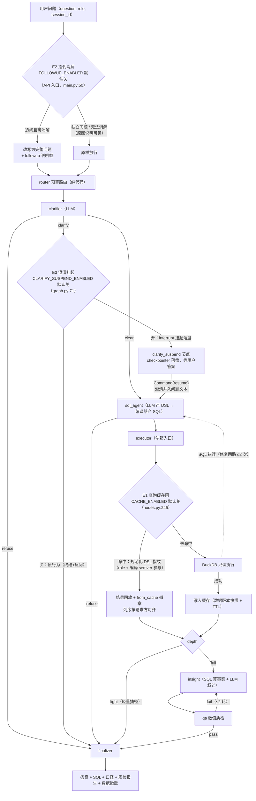

# PROJECT BOOK · AskBI 问数引擎

> 六节标准版（对齐底座三件套格式，2026-11-05 补齐）+ 原书正文存档。配套：[README](../README.md)｜[EVIDENCE.md](../EVIDENCE.md)（证据链首页）｜[STUDY_GUIDE.md](STUDY_GUIDE.md)｜[INTERVIEW.md](INTERVIEW.md)（16 道深挖题）｜[DESIGN.md](DESIGN.md)。
> 阅读指引：§0-§6 是六节速览与面试导航；"原书正文存档"区从《1. 项目定位》起到《9. 扩展篇》止**原样保留**（其内部"§4.2/§5.6"等引用仍指存档区原节号，STUDY_GUIDE 的"PROJECT_BOOK 第 4 节"引用不受影响）。数字权威口径 = §0 数字台账 + EVIDENCE.md。

---

## 0. 一页定位

**是什么**：多 Agent 对话式经营分析系统（ChatBI）——业务人员用自然语言提问，一组协作 Agent 产出**带口径、数字可溯源、过完质检**的分析答案，全程 SSE 流式可视。一句话架构：LangGraph 七节点状态机（路由→澄清→NL2DSL→沙箱执行→归因→质检→组装）+ FastAPI/SSE + DuckDB 只读沙箱 + RAG 样例检索 + MCP 数据服务 + 三层评测体系。

**回答哪道面试必答题**：ChatBI/NL2SQL 岗 JD 的核心三问都能指到代码——"幻觉数字怎么防"（确定性/不确定性分层 + QA 逐数核验闭环）、"SQL 注入怎么防"（NL2DSL2SQL 三段式，LLM 只产白名单 DSL）、"数据权限怎么做"（行级权限编译期注入而非 SQL 改写）。多 Agent 编排、缓存、多轮、human-in-the-loop 各有独立 ADR 与消融数字。

**组合叙事**：检索增强（policy-compass）→ **工具编排与数值可信（askbi，本仓库）** → 底层引擎（miniagent）→ 评测量化（agenteval）→ 认知记忆（memomind）→ 网关与多租户（agentgate）。askbi 承担的位置是"多 Agent 协作 + 结果可信"：policy-compass 证明检索正确，askbi 证明**数字正确**。

**简历一句话版**：多 Agent 对话式 BI（LangGraph 七节点 + NL2DSL2SQL 受控编译 + DuckDB 只读沙箱，137 项测试）：v2 分层集 116 条 real 94.8%（数值一致率 100%）、13 条 holdout 盲测不参与调参、关质检消融归因类 12/12→5/12（QA 闭环 +58pp）、多轮 30 条 64 轮 mock 100%、故障注入 6 场景×10 零崩溃、三数据源上层零改动（DatasetSpec 注册表：订单/小票/账单三套物理模型）、管理面审计日志（变更与审计同窗口落盘）。

**数字台账（全部实跑口径，mock 与 real 严格分列）**：

| 层 | 数字 | 出处 |
|---|---|---|
| 测试 | pytest **137 项全绿** | `python -m pytest -q` |
| 单轮 real | v1 33 条 **100%**；v2 116 条 **94.8%**（110/116，数值一致率 100%；query 79/80 · drill 12/12 · clarify 12/12 · refusal 7/12，成本 560,550 token） | eval/report_openai_compatible_dataset_v2.md |
| 单轮 mock | v1 33 条 **100%** / v2 116 条 **100%**（金标由 compile_sql 生成+构建期自检） | eval/report_mock_dataset_v2.md |
| **holdout 纪律** | 13 条 holdout **盲测两轮 84.6%/100%**，**不参与调参**——clarifier 校准只用 main split 失败信号 | eval/report_openai_compatible_dataset_v2_holdout*.md |
| 消融 | 关 QA 修订循环 real **93.1%**：drill **12/12→5/12**（**QA 闭环 +58pp**）、数值一致率 100%→95.5% | eval/report_openai_compatible_dataset_v2_no_qa.md |
| 多轮 | 30 条 64 轮：mock **100%**；real **24/30 条目、57/64 轮=89.1%**（机制场景全绿：指代消解 16/17、缓存复问 10/10、行级权限 6/6；失败全在边界探针=预期差异） | evidence/multiturn_report_real.md |
| 可靠性 | 故障注入 6 场景×10 次**零崩溃**；压测双口径：进程内 110-124 QPS（10-28 存档）+ HTTP 全栈（11-05，[evidence/load_test_http.md](../evidence/load_test_http.md)） | evidence/ |
| 多数据源 | coffee B 集 26 条 mock **100%** + saas C 集 26 条 mock **100%**（DATASET=coffee|saas 一键切换，三源三套物理模型上层零改动；C 集构建期自检真抓出 tier 词表首词命中顺序 1 条） | eval/report_mock_dataset_b.md / report_mock_dataset_c.md |
| ADR 清单 | [adr.md](adr.md) ADR-1~5（DSL 层/DuckDB/QA 确定性/预算路由/MCP）+ [cache_adr.md](cache_adr.md) + [followup_adr.md](followup_adr.md) + [clarify_suspend_adr.md](clarify_suspend_adr.md) + [multiturn_adr.md](multiturn_adr.md) + [registry_adr.md](registry_adr.md)；导出（app/export.py）与 thumbs 反馈闭环无独立 ADR，实现决策记录在 [EVIDENCE.md §1](../EVIDENCE.md) | docs/ |

## 1. 技术栈全景（每一层"选了什么、为什么、放弃了什么"）

完整选型对比表在原书存档 §3（含被否方案），此处只列结论链：LangGraph 1.x StateGraph（显式状态机表达回路+流式，放弃 AutoGen/自研循环）｜FastAPI + SSE + pydantic v2（全异步类型即契约，放弃 WebSocket/DRF）｜DuckDB 单文件只读（列存聚合快零部署，生产换数仓时 DSL 编译器换 target）｜NL2DSL2SQL 三段式（白名单 DSL 编译期注入治理，放弃直接 NL2SQL）｜TF-IDF 字符二元组 RAG（中文短问句够用、零下载、确定性，chroma 可选）｜OpenAI 兼容 provider 工厂（DeepSeek/GLM/Qwen 一环境变量切换）｜MockLLM 规则解析器（CI 无 key 可跑、测得了正确性）｜MCP 2.x stdio（指标能力开放给任意 MCP 客户端）。额度限制下的显式取舍：无 embedding 配额 → 检索用词面方法（诚实声明于原书 §3）。

## 2. JD 要求映射表（JD 原文 → 代码位置 → 面试指路一句话）

| JD 关键词 | 对应实现 | 面试指路一句话 |
|---|---|---|
| "NL2SQL / ChatBI / Text2SQL" | app/data/dsl.py（QueryDSL 白名单校验 + compile_sql 编译器）+ app/data/metrics.py（指标字典） | "LLM 只产受白名单约束的 DSL，物理 SQL 由编译器渲染——注入面在编译期归零" |
| "多 Agent 编排 / LangGraph" | app/agents/graph.py（七节点 + 条件边 + SQL 修复/QA 修订双回路 + 轻量捷径） | "两条回路两条捷径都在图拓扑里，节点失败语义逐个有测试" |
| "Agent 工具调用 / Function Calling" | app/data/sandbox.py（只读连接+语句守卫+超时 interrupt）+ app/mcp/（MCP Server） | "工具=SQL 沙箱，物理只读、黑名单、多语句拒绝，LLM 不可达" |
| "RAG" | app/rag/example_store.py（问题→DSL 样例检索，TF-IDF 默认/chroma 可选） | "RAG 用来注入 few-shot 而不是召回文档，检索器可插拔" |
| "SSE / 流式" | app/api/main.py /api/ask（node_done/event/final 三类帧） | "执行过程逐节点流式，前端流水线面板同源消费" |
| "数据权限 / 合规" | dsl.py ROLE_SCOPES 编译期注入 + 原书 §5.3 四层防御 | "控制 SQL 生成端就从源头注入，改写任意 SQL 是出名的难题" |
| "幻觉 / 质检" | agents/nodes.py check_numbers 数值核验 + QA 修订回路（消融 +58pp） | "质检器不能依赖被检对象——确定性核验才进得了 CI" |
| "成本优化 / 缓存" | app/cache.py（同 DSL 指纹 + TTL/数据版本/编译 semver 三闸，压测 +12%） | "最便宜的 LLM 调用是不调用；role 参与指纹防权限破防" |
| "多轮对话" | app/context.py（指代消解）+ graph.py clarify_suspend（interrupt 挂起） | "两种 HITL 语义对照：改写输入 vs 暂停等输入，开关独立" |
| "评测体系 / prompt 迭代" | app/eval/runner.py + scripts/build_dataset_v2.py（金标可重建自检） | "三层评测 + holdout 纪律 + 消融开关，评测指挥了整个调优" |
| "多数据源 / 语义层" | app/data/registry.py（DatasetSpec 注册表，coffee+saas 双实证上层零改动） | "维度/指标/词表全是可注册数据，图/节点/QA 无一行 if dataset" |
| "可观测 / 治理" | /api/metrics token 看板 + app/audit.py 管理面审计（变更与审计同窗口）+ /api/feedback 反馈闭环 | "谁在何时通过什么改了什么可追溯——审计失败变更回滚" |

## 3. 全流程实现走读（一次 `/api/ask` 的完整生命）

完整七阶段流水线与逐请求走读见原书存档 §4（含三条回路两条捷径）；三扩展（缓存/消解/挂起）改写走读哪几步的全景 mermaid 见存档 §9.3。压缩版十步：①SSE 请求入 API（可选指代消解改写）→ ②router 纯代码预算路由定 depth → ③clarifier LLM 判 clear/refuse/clarify（挂起开关下反问可 interrupt 落盘）→ ④sql_agent 产 DSL → ⑤pydantic 枚举校验+编译器渲染 SQL（权限/时间锚点/LIMIT 注入）→ ⑥executor 沙箱只读执行（缓存闸在最前：命中直接回放）→ ⑦insight：drill_down 纯 SQL 算环比/维度分解，LLM 只拿事实写人话 → ⑧qa 逐数核验（编造→打回重写 ≤2 轮）→ ⑨finalizer 组装答案+SQL+口径+质检报告+数据徽章 → ⑩任务落盘 tasks.jsonl（回放/导出/审计全链可追溯）。

## 4. 代码内化路线（含重写关卡）

**阅读顺序**（每步带验证）：①scripts/demo.py 五问建立全局 → ②app/data/（schema→metrics→dsl→sandbox，数据侧白名单链）→ ③app/agents/nodes.py 七节点实现 → ④app/agents/graph.py 装配（对照原书 §4.3 回路图）→ ⑤app/api/main.py SSE 接线 → ⑥扩展三件套 cache.py/context.py/挂起装配（各配 ADR）→ ⑦tests/ 按模块对照。STUDY_GUIDE §4/§6 是本路线的展开版。

**重写关卡**（判卷标准=对应测试文件，白板重写后跑绿才算过）：

| 关卡 | 重写什么 | 判卷标准 |
|---|---|---|
| K1 | compile_sql 权限注入链（角色作用域→WHERE 注入→LIMIT 钳制） | tests/test_compiler.py + test_row_level_permission |
| K2 | canonical_dsl 四层归一 + QueryCache 三闸时序（TTL 锁内→版本锁外→二次拿锁重查→semver） | tests/test_cache.py 18 项 |
| K3 | is_followup 三重门槛 + 两层实体归一 | tests/test_followup.py |
| K4 | interrupt 挂起双态图（落盘→Command(resume)→节点重执行） | tests/test_clarify_suspend.py |
| K5 | 管理面同窗口审计（变更→审计→失败回滚） | tests/test_audit.py |

**必做实验**：改指标表达式看 semver 全缓存失效（test_semver_change_invalidates）、`scripts/eval_cache.py` 开关缓存逐条 diff、`--ablation no_qa/sloppy` 看质检闭环价值、`scripts/fault_inject.py --n 10` 看降级语义、`scripts/load_test.py` + `scripts/load_test_http.py` 对照进程内与 HTTP 全栈（c=1 差值=附加开销）。详见原书存档 §9.4。

## 5. 面试深挖 10 问与追问防御

每问格式：一句答案 → 追问三连锚点（行号）。逐题完整版在 INTERVIEW.md（16 问）。

1. **"为什么不直接 NL2SQL？"**——白名单 DSL 让注入/幻觉表名在编译期不可达，DSL 可 diff 可单测。追问：值注入怎么防（转义+取值枚举双保险，dsl.py validate_filter_values）；表达力不够怎么办（明确拒答，80% 问题落在指标×维度×过滤×时间空间）；口径怎么统一（指标字典唯一来源，metrics.py）。
2. **"100 万用户先崩在哪？"**——成本层先崩→意图缓存已实现（cache.py）；追问：缓存脏数据（三闸：TTL+数据版本+编译 semver，role 参与指纹）；评测集上零命中怎么办（诚实答：收益在生产高重复流量，盯 stats().hit_rate）；数据层崩（DuckDB 换数仓=编译器换 target）。
3. **"编造数字怎么防？"**——确定性分层：归因数字全部 SQL 算，LLM 只拿事实写叙述；QA 逐数核验+修订回路。追问：消融证据（no_qa drill 12/12→5/12=+58pp）；核验器误判（日期/时长豁免，评测迭代第二轮）；核验器自己错了怎么办（确定性核验可单测，质检器不依赖被检对象）。
4. **"多轮对话怎么设计？"**——两层：指代消解改写输入（保守规则，判不出走澄清兜底）+ 澄清挂起暂停等输入（interrupt+checkpointer）。追问：上下文存什么（一行问题文本，隐私面最小）；误判方向（宁可当独立问题不可答错）；与 miniagent 权限确认的对照（两种 HITL 挂起语义）。
5. **"行级权限为什么做在编译层？"**——控制 SQL 生成端从源头注入，改写任意 SQL 可被 CTE/子查询绕过。追问：角色怎么建模（ROLE_SCOPES 声明式）；缓存会不会破权限（role 显式参与指纹，cache.py:111）；跨数据源呢（权限作用域随 DatasetSpec 声明）。
6. **"LLM 挂了/返回垃圾怎么办？"**——指数退避重试+四节点降级语义（澄清放行/生成拒答/叙述留空/质检回退确定性）。追问：怎么证明（故障注入 6 场景×10 零崩溃）；SQL 超时（interrupt() 跨线程打断）；错误会不会被缓存（错误结果不缓存，仍走修复回路）。
7. **"换个数据源要改多少代码？"**——零上层改动：DatasetSpec 注册表（维度/指标/取值白名单/NL 词表全声明式）。追问：证据（coffee 26/26 + saas 26/26 mock 双 100%，95 项存量测试零改动）；同 DSL 跨源缓存（数据集标识参与指纹，互不命中）；RAG 样例库边界（未按源隔离，诚实声明于 EVIDENCE §6）。
8. **"怎么证明你的数字可信？"**——三层评测（单轮 116+多轮 64 轮+holdout 13）+金标由 compile_sql 生成可重建+mock/real 分列。追问：holdout 纪律（不参与调参，clarifier 校准只用 main split）；失败归因（94.8% 的 6 条逐条有 trace 归因）；评测污染怎么防（构建期自检 mock 可答性）。
9. **"管理面操作怎么追溯？"**——审计日志：谁在何时通过什么改了什么，变更与审计同窗口落盘，审计写失败变更回滚。追问：agentgate 是 DB 同事务、askbi 无 DB 怎么翻译（同锁窗口+回滚，app/audit.py 模块头）；密钥会不会进审计（detail 只放计数/文件名/开关 from→to）；多 worker 边界（归档改名假定单 worker，PRODUCTION_GAP）。
10. **"压测怎么做的，数字可信吗？"**——双口径：进程内（编排+SQL 本体）+ HTTP 全栈（uvicorn 真进程 SSE 全链）；c=1 差值=附加开销，health 地板检验客户端瓶颈。追问：为什么 c=1（高并发差值混入排队，agentgate 教训）；瓶颈归属（LLM 串行调用次数×延迟，HTTP 是常数项）；缓存收益（进程内 +12%，HTTP 口径复现见 evidence/load_test_http.md 表3）。

## 6. 边界与演进（诚实声明）

- 评测是 mock 可判定集（措辞对齐解析器词表），真实模型泛化上限由 real 报告失败明细界定；holdout 13 条不参与调参。
- 未上生产：无真实 DAU/QPS，压测是 mock+模拟延迟形态；数据是固定种子合成（可复现是评测前提）。
- DSL 表达力有边界（窗口函数/复杂嵌套不支持）——覆盖不了明确拒答。
- RAG 样例库未按数据集隔离（真实 provider 下 coffee/saas 问题会检索到电商 few-shot，mock 不受影响）；多轮词表取默认数据集（followup 默认关）。
- 审计日志多 worker 部署注记：JSONL 追加多进程可交叉，任务清除归档改名假定单 worker 口径（PRODUCTION_GAP）。
- 演进方向：LangGraph checkpointer 持久化（SqliteSaver/PostgresSaver）、sql_agent 升级原生 Function Calling、DuckDB 换数仓 target、RAG 样例库按源隔离。完整清单见原书存档 §8 与 PRODUCTION_GAP.md。

---

# 原书正文存档（2026-10 成书 + 10-28 扩展篇，原样保留）

# AskBI 项目书

> 本文是项目的完整技术叙事：业务背景 → 技术栈 → 整体流程 → 系统设计 → 具体实现 → 评测结果 → 边界与演进。
> 配套阅读：[STUDY_GUIDE.md](STUDY_GUIDE.md)（代码学习路径与面试重点）、[DESIGN.md](DESIGN.md)（设计决策表）、[INTERVIEW.md](INTERVIEW.md)（深挖预演）。

---

## 1. 项目定位

**AskBI 问数引擎**是一个多 Agent 对话式经营分析系统：业务人员用自然语言提问（"上月华南哪个品类毛利率最低，为什么下滑？"），一组协作的 Agent 产出**带口径、数字可溯源、过完质检**的分析答案，全程执行过程流式可视。

一句话架构：**LangGraph 多 Agent 编排（路由→澄清→NL2DSL→沙箱执行→归因→质检→组装）+ FastAPI/SSE 后端 + RAG 样例检索 + MCP 数据服务 + 可判对错的评测体系**。

## 2. 业务背景

### 2.1 场景与付费方

中小电商/零售公司普遍没有专职数据团队：老板和运营想问"上月哪个品类毛利率下滑最多"，只能提需求等排期，或自己下载数据在 Excel 里折腾。对话式 BI（ChatBI）把这件事变成"对话即答案"。

这不是想象的需求——**腾讯云 ChatBI、阿里瓴羊智能小Q（2025 年升级为 Agent 体系）、火山引擎 DataWind ChatBI 均为在售商业产品**，这是被云厂商验证过的付费市场。做这个项目等于对齐目标公司的真实产品线。

### 2.2 企业级痛点（项目的四个"认真"）

| 痛点 | 真实后果 | AskBI 的回答 |
|---|---|---|
| **口径治理** | "毛利率"在两张报表里算法不同，开会吵一小时 | 指标字典：每个指标唯一权威 SQL 表达式+口径说明，随答案输出 |
| **数据权限** | 大区运营看到其他大区数据=事故 | 行级权限在编译期注入 WHERE，角色外数据物理不可见 |
| **数字不可信** | LLM 生成的报表数字没人敢用 | 数值确定性分层+QA 逐数核验，编造数字被打回重写 |
| **幻觉与瞎猜** | 问不到的东西模型编一个 | 歧义反问澄清、数据外明确拒答，拒答正确率是独立评测指标 |

### 2.3 生态位（诚实引用）

| 项目 | 思路 | 它没解决的（= 本项目主线） |
|---|---|---|
| Vanna | RAG 式 text2sql（问题-SQL 对→向量库） | 语义歧义场景弱、无质检闭环 |
| WrenAI | MDL 语义层+流水线 | 会话仅限 SQL 场景、无修订循环 |
| DB-GPT | 重型 AI 数据应用框架 | 输出质量无守护、上手成本高 |
| 腾讯云 ChatBI（商业闭源） | NL2DSL2SQL 中间层路线 | 本项目用开源栈验证该路线的引擎级实现 |

## 3. 技术栈与选型理由

| 层 | 选型 | 为什么 | 放弃了什么 |
|---|---|---|---|
| 编排 | LangGraph 1.x（StateGraph） | 显式状态机+条件边天然表达"回路"（SQL 修复、QA 修订）；支持流式 | AutoGen（对话式编排，状态管理弱）；自研循环（失去 checkpoint 生态） |
| 后端 | FastAPI + SSE + pydantic v2 | 全异步、类型即契约、SSE 十几行实现流式 | WebSocket（单向推送用不上）；DRF（同步模型不适配） |
| 存储/计算 | DuckDB（单文件，只读连接） | 列存分析聚合快、零部署、`read_only=True` 物理只读 | SQLite（分析弱）；Postgres+pgvector（部署重）；生产换数仓时 DSL 编译器换 target 即可 |
| RAG | TF-IDF 字符二元组（默认）/ chroma（可选） | 中文短问句够用、零模型下载、完全确定性、毫秒级 | 强行上语义检索（引入非确定性与下载依赖——"够用的最简方案优先"） |
| LLM 接入 | OpenAI 兼容 SDK + provider 工厂 | DeepSeek/GLM/Qwen/DashScope 一个环境变量切换 | 锁定任何一家 SDK（负债） |
| mock | 规则版 NL→DSL 解析器 | CI 端到端无 key 可跑；评测先验流水线再验模型 | "假 LLM 随机返回"（测不了正确性） |
| 协议 | MCP 2.x（MCPServer stdio） | 指标查询能力开放给任何 MCP 客户端（Claude Desktop 等） | 私有 API（协议生态是趋势） |
| 质量保障 | pytest + 33 条可判对错评测 + 消融开关 + GitHub Actions | 评测即回归，prompt 改动有护栏 | 只测"能不能跑通"的冒烟测试 |
| 前端 | 原生 JS 单页 + vega-lite CDN | 零构建步骤、演示直观 | React/Next.js（演示场景收益低） |

## 4. 整体流程

### 4.1 七阶段流水线

```
问题 → ① router 预算路由（纯代码）
         ├─ 轻量链路：①→②→③→④→⑦          （简单聚合，2 次 LLM 调用）
         └─ 完整链路：①→②→③→④→⑤→⑥→⑦     （归因/趋势/对比，4 次 LLM 调用）
② clarifier 意图澄清（LLM）──── 歧义→反问（挂起）；数据外→拒答；清晰→放行
③ sql_agent（LLM）→ DSL（白名单校验）→ 编译器（纯代码）→ SQL（注入权限+LIMIT）
④ executor 沙箱（纯代码）─────── DuckDB 只读执行；SQL 错→带错误回③修复（≤2 次）
⑤ insight（SQL 算事实 + LLM 解读）─ 环比/维度贡献分解全部 SQL 计算，LLM 只讲人话
⑥ qa 数值质检（代码核验+LLM 语义）─ 叙述逐数溯源，编造→带反馈打回⑤（≤2 轮）
⑦ finalizer 组装（纯代码）─────── 结论+图表+SQL+口径+质检报告+数据徽章
```

### 4.2 一次完整请求走查（以"为什么上月美妆品类毛利率下滑了"为例）

1. **router**：命中"为什么"→ `depth=full`，事件 `{"depth":"full","reason":"包含归因语义..."}`
2. **clarifier**：指标（毛利率）、时间（上月→锚点 2026-09）都明确 → `clear`
3. **sql_agent**：RAG 检索出 3 条相似样例注入 few-shot → 产出 DSL `{intent: aggregate, metric: gross_margin_rate, filters: [{category=美妆}], time: last_n_months n=1}` → pydantic 枚举校验+取值校验 → 编译器渲染 SQL（隐含 JOIN 四表、GROUP BY 无、权限作用域按角色注入）
4. **executor**：只读连接执行 → 当月毛利率 0.4402
5. **insight**：先跑 `drill_down`（**纯 SQL**）：环比上月 0.5035→0.4402（**-12.6%**）；按渠道分解——推荐 -0.0684、直播 -0.064、社交 -0.0626；按区域分解——东北 -0.0667、华东 -0.05...；再取近 12 个月月度序列。LLM 拿着这些**已计算好的事实**写叙述，铁律是禁止出现事实之外的数字
6. **qa**：正则抽取叙述中所有数字（剥离日期/时长），与结果集+事实做带容差匹配（百分比分域、千分位、正负号表达归一）→ 全部命中 → LLM 补语义核验 → `passed`
7. **finalizer**：组装答案，附 SQL、口径（"毛利率=毛利额/折后销售额"）、质检报告、数据徽章（行数/耗时/截断标记）

全程每个节点产出 trace 事件，SSE 推给前端流水线面板，任务落盘 `data/tasks.jsonl`。

### 4.3 三条回路、两条捷径

- **SQL 修复回路**：executor 报错 → 错误信息回灌 sql_agent 重试（≤2 次）→ 超限降级为明确拒答
- **QA 修订回路**：质检不过 → 整改反馈回灌 insight 重写（≤2 轮）→ 超限**带失败徽章输出**（降级而非吞掉）
- **轻量捷径**：简单聚合跳过 ⑤⑥（LLM 调用 4 次→2 次）
- **拒答捷径**：clarifier/sql_agent 判定越界 → 直达 finalizer

## 5. 系统设计

### 5.1 核心哲学：确定性/不确定性分层

> 面试官视角的标准问法："哪些环节必须用 LLM 的模糊推理，哪些必须用硬编码锁死？"

| 环节 | 实现 | 理由 |
|---|---|---|
| 预算路由 | **纯代码**（正则规则） | 廉价规则省下整套多 Agent 开销，错了代价可接受 |
| 歧义判定 | LLM | 歧义是语义问题，规则枚举不完 |
| 意图→DSL | LLM（白名单约束） | NL 多样性必须模型兜；输出被 pydantic 枚举锁死 |
| DSL→SQL | **纯代码编译器** | 指标表达式唯一来源是字典，注入面归零 |
| SQL 执行 | **纯代码沙箱** | 物理只读，LLM 不可达 |
| 归因计算 | **纯代码（SQL 聚合）** | "为什么"的数字必须可复算 |
| 叙述 | LLM | 讲人话是模型的事；输入只有已算好的事实 |
| 数值核验 | **纯代码** | 质检器不能依赖被检对象；确定性核验才能进 CI |
| 口径说明 | **字典直出** | 版本化、可审计 |

**LLM 负责"理解与表达"，代码负责"计算与守护"，边界写死在图结构里。**

### 5.2 NL2DSL2SQL：为什么不直接 NL2SQL

1. **安全**：LLM 产出只含白名单枚举字段，物理标识符由编译器渲染——提示注入、幻觉表名在编译期不可达；值经转义+取值枚举双保险
2. **可控可解释**：DSL 可 diff、可单测（编译器是纯函数）；直接生成的 SQL 是黑盒
3. **口径统一**：8 类指标唯一来源是指标字典
4. **治理注入点**：行级权限、LIMIT 钳制、时间锚点在编译期统一注入，LLM 无法绕过

代价：DSL 表达力有边界（不支持窗口函数等）——覆盖不了就明确拒答。取舍依据：经营分析 80% 问题落在「指标×维度×过滤×时间」空间内。

### 5.3 安全模型：四层纵深防御

| 层 | 机制 | 测试锚点 |
|---|---|---|
| 连接层 | `duckdb.connect(read_only=True)` 物理不可写 | `test_readonly_is_physical` |
| 语句层 | 单条 SELECT/WITH、危险词黑名单、多语句拒绝、掩码列拒绝 | `test_sandbox.py` 全组 |
| 编译层 | 指标/维度/过滤全枚举、值转义、limit 钳制 ≤200 | `test_compiler.py` 全组 |
| 权限层 | 角色→区域作用域编译期注入 | `test_row_level_permission` |

行级权限做在编译层而非 SQL 改写层的关键判断：改写任意 SQL 是出名的难题（子查询/CTE 都能绕过），**控制了 SQL 生成端就从源头注入**——这是选择 DSL 路线的又一回报。

### 5.4 失败降级矩阵

| 故障 | 行为 | 用户所见 |
|---|---|---|
| LLM 输出不合法 | 带错误反馈重试 1 次→仍失败拒答 | 明确拒答 |
| SQL 执行错误 | 修复循环 ≤2 次→拒答 | 带错误详情 |
| SQL 超时 | `interrupt()` 跨线程打断 | 拒答说明超时 |
| 空结果（权限外/无数据） | 规范化为空结果+原因 | "权限范围外"而非 NULL |
| 质检发现编造数字 | 打回重写 ≤2 轮→**带失败徽章输出** | 红色质检报告 |

原则：**宁可说"我不知道"，不编数字。拒答是能力不是缺陷。**

### 5.5 状态与记忆（三层）

- **工作记忆**：LangGraph State（问题/DSL/结果/事实/反馈），单任务生命周期
- **情景记忆**：任务库 JSONL 追加日志，可回放、重启恢复
- **语义记忆**：RAG 样例库（问题→DSL 对），成功查询可回流，越用越准

### 5.6 预算路由与成本

简单问题走轻量链路（LLM 调用 4→2 次）；每节点 token 记账 → `/api/metrics` 看板；评测输出 P50/P95 延迟与 token 总量。真实评测实测：全量 33 条约 15.1 万 token（<¥0.5）。回答"100 万用户先崩在哪"：成本层→意图缓存；数据层→DuckDB 换数仓（DSL 编译器换 target）；质量层→评测集即回归护栏。

## 6. 具体实现（模块地图）

```
app/
├── config.py            # pydantic-settings 单一配置源，.env 覆盖
├── llm/
│   ├── base.py          # LLMClient 协议 + ChatRequest/Response（node 字段用于记账与 mock 分发）
│   ├── deepseek.py      # OpenAI 兼容客户端（json_mode + 容错解析）
│   ├── mock.py          # 规则版 LLM：clarifier/sql_agent/insight/qa 四个确定性处理器
│   └── factory.py       # provider 装配
├── data/
│   ├── schema.py        # 维度白名单、掩码列、维度取值枚举、schema_prompt（含时间锚点）
│   ├── metrics.py       # 指标字典：8 类指标权威表达式+别名+口径说明
│   ├── dsl.py           # QueryDSL 模型（pydantic 全枚举校验）+ compile_sql（权限注入/LIMIT 钳制）+ 行级角色
│   ├── sandbox.py       # guard 语句守卫 + 只读连接 + 超时 interrupt + 结果规模钳制
│   ├── generator.py     # 固定种子电商数据：美妆折扣故事、渠道迁移、季节性
│   └── analytics.py     # drill_down：环比 + 维度贡献分解 + 月度序列（全 SQL）
├── agents/
│   ├── state.py         # GraphState TypedDict：全节点共享的数据总线
│   ├── nodes.py         # 七节点实现 + check_numbers 数值核验 + 预算路由
│   └── graph.py         # LangGraph 装配：条件边、回路、轻量捷径
├── rag/example_store.py # ExampleStore 接口 + TF-IDF（默认）/ chroma（可选）双后端 + 种子样例
├── mcp/                 # core.py（传输无关的工具逻辑）+ server.py（MCPServer stdio）
├── api/                 # FastAPI：/api/ask(SSE)、tasks 回放、schema、metrics 看板、可选 API Key
└── eval/runner.py       # 评测：执行准确率（top-k 等价判定）+ 拒答/澄清/归因 + 消融 + 报告生成
web/index.html           # 问数工作台：流水线可视化 + 执行日志 + vega 图表 + 质检徽章
tests/                   # 76 项：守卫注入/编译器/解析器/QA核验/端到端/API/缓存/指代消解
```

**数据集设计**（`generator.py`，固定种子 42，24 个月，约 10.4 万订单/19.8 万明细）：可复现是评测的前提。数据里埋了三个"业务故事"信号作为归因素材——①美妆品类 2026-05 起折扣拉高、9 月促销加码（毛利率环比 -12.6%，可按渠道/区域下钻）；②直播渠道占比 12%→34% 结构迁移；③服饰 11-12 月/6 月季节性。**所有数字来自 SQL，没有一个来自模型。**

## 7. 评测体系与结果

### 7.1 设计原则：可判对错

- **query（24 条）**：生成 SQL 与 gold SQL 在同一库执行，结果集排序后逐行比对（4 位小数）——**不评"像不像"，评"对不对"**；含 top-k 语义等价判定（"哪个品类最低"返回排序前 k 行视为等价）
- **refusal（4）/ clarify（3）**：行为正确性
- **drill（2）**：归因链路完整 + 数值核验通过
- **消融开关**：`--ablation no_qa`（关修订循环）、`--ablation sloppy`（mock 注入编造数字）

### 7.2 真实模型结果（deepseek-v4-flash-0731 @ DashScope，2026-10-26）

| 指标 | 完整系统 | 消融：关闭 QA 修订循环 |
|---|---|---|
| 端到端准确率 | **100%**（33/33：query 24/24，拒答 4/4，澄清 3/3，归因 2/2） | 93.9% |
| 叙述数值一致率 | **100%** | 90.9% |
| 延迟 | avg 31.2s / p95 114s（p95 由修订循环主导） | avg 23.9s |

mock 流水线验证 33/33（CI 无 key 可复现）；sloppy 注入 2/2 被拦截。

### 7.3 三轮迭代（Eval 驱动调优的故事）

1. **87.9%**：①模型不知数据截止月，把"上月"当歧义 → prompt 注入时间锚点（"数据截止 2026-09，上月=2026-09，系统约定无需澄清"）；②模型对"哪个品类最低"自设 limit=5 与 gold 口径不合 → prompt 固化 limit 约定（仅"前N"显式才设）+ 判定加 top-k 等价；③"黑卡会员"偶发误拒 → schema prompt 补维度取值枚举
2. **97.0%**：数值核验把"近12个月"的时长误判为业务数字 → 核验器豁免日期/时长（时间坐标不是量值）
3. **100%**，数值一致率 100%

每轮都由评测集精确定位、修复、回归——**评测体系指挥了整个调优过程，这就是"Eval 即 CI"的意义**。

## 8. 已知边界与演进方向

1. DSL 表达力有边界：窗口函数、复杂嵌套不支持——覆盖不了就拒答（主动交代比被问出来好）
2. 澄清是一次性的：真正的 human-in-the-loop 需要 LangGraph checkpointer + interrupt（演进方向一）
3. sql_agent 走 JSON mode 而非原生 Function Calling——可改造为 @tool 注册（演进方向二，也补齐 JD 关键词）
4. DuckDB 单文件无写路径：生产形态是接数仓（演进方向三：DSL 编译器换 target）
5. 评测集是自建的 33 条（gold SQL 手写、数据固定种子）：结论是"在此基准上"，不是通用声明

---

*项目不代表任何公司产品；演示数据为脚本生成的模拟经营数据，不构成任何投资/经营建议。*

---

# 9. 扩展篇（2026-10-28 增补）——三个原创扩展

> 本篇只增不改：原书 §1-§8 成书于系列原创扩展落地之前，原书任何段落保持原样，本篇补记其中 askbi 仓库内新落地的三个扩展。每个扩展带第一人称 ADR（[cache_adr.md](cache_adr.md) / [followup_adr.md](followup_adr.md) / [clarify_suspend_adr.md](clarify_suspend_adr.md)）、回归测试与对抗性评审记录（工作区级 `interview/reviews/review_report.md`，位于 askbi 仓库外）。
> 测试分账（2026-10-28 实测复核，pytest 76 passed）：**44 项既有 + 缓存 17 + 消解 11 + 挂起 4 = 76**。三个扩展的开关全部默认关闭（config.py:45-49），关闭态与原书描述的行为逐字一致。

## 9.1 三个扩展：动机 → 核心机制 → 与原架构的关系

### 扩展一：查询缓存回放（app/cache.py）

- **技术栈**：纯 Python——hashlib SHA256 指纹 + OrderedDict（近似 LRU）+ threading.RLock + duckdb 只读连接做数据版本指纹；无任何外部依赖。
- **解决什么面试必答题**：原书 §5.6 埋的点——"100 万用户先崩在哪？成本层→意图缓存"。原书答案停在"应该做"，本扩展把它变成"已实现且可验证"：BI 查询重复率极高，DuckDB 执行一次只要 40ms，真正贵的是上游 LLM 调用。**最便宜的 LLM 调用是不调用**——同 DSL 指纹命中时，澄清/意图生成/编译/执行整条链路全部短路，直接回放结果集。
- **核心机制**（完整决策见 [cache_adr.md](cache_adr.md)）：
  1. 缓存键 = **规范化 DSL 的 SHA256 指纹**而不是原文（`canonical_dsl`，cache.py:98-121）：只保留影响 SQL 语义的字段（intent 从不参与编译，直接丢弃）→ 维度/过滤/IN 列表排序归一 → 相对时间解析为绝对月窗口（与编译器共用 `_END_MONTH` 锚点避免两处漂移，cache.py:30、dsl.py:59）→ **role 显式参与指纹**（cache.py:111）——行级权限在编译期注入，同 DSL 不同角色结果不同，绝不允许跨角色复用缓存。
  2. 失效**三闸**：TTL 300s（兜住一切"漏失效"的最大错误窗口）+ 数据版本号（读时计算 DuckDB 数据集指纹，变化即全量失效，cache.py:135-150）+ **编译语义版本**（`_compile_semver` 对指标表达式集合做短哈希，口径/编译器语义变更→全缓存失效，cache.py:38-53——第三闸是对抗性评审 A1 补上的，见 9.5）。
  3. 列对齐回放（`align_columns`，cache.py:298-311）：维度归一排序后，命中结果的列序可能与请求方不同——按请求方重排列（编译器保证列结构恒为"维度...+value"，可安全重排）。
  4. 进程内 OrderedDict 近似 LRU（上限 256）+ RLock 线程安全 + 六计数器（hits/misses/ttl_expired/version_invalidations/stores/evictions，`stats()` 可观测）。
- **与原架构的关系**：插在 executor 执行路径最前（nodes.py:243-260）——命中→回放+`from_cache` 徽章（进 data_badge，nodes.py:516），未命中→沙箱→执行成功后写入（nodes.py:287-288，空结果也缓存防穿透，错误结果**不**缓存、仍走 SQL 修复回路）。`CACHE_ENABLED` 默认 False（config.py:45），关闭时 get/set 直通、执行路径与无缓存版本完全一致——这是"44 项既有测试一行不改仍然全绿"的保证。缓存键含 role 与 semver，复用的正是原书 §5.2"治理注入点在编译期"的同一前提。
- **诚实记录**：正确性评测 33/33 逐条一致（`python scripts/eval_cache.py` 开/关缓存双跑逐条 diff，PASS），但平均耗时 **82ms→105ms——反而变慢**（eval/report_mock_cache_off.md vs report_mock_cache_on.md）：评测集 33 条全是唯一查询，零命中，指纹+版本计算成纯开销。**缓存的价值在生产高重复查询流量里，评测验证的是"缓存不改变答案"**（cache_adr.md §5）。

### 扩展二：多轮指代消解（app/context.py）

- **技术栈**：纯 Python——re 正则句式匹配 + OrderedDict LRU 会话表；零模型调用、零存储依赖。
- **解决什么面试必答题**：真实 BI 对话里追问占三分之一以上（"上月华南毛利率"之后必来"那华北呢"），原架构每问独立单轮，追问被当新问题重新走澄清——体验断裂。对应新增 JD 考点"**多轮对话怎么设计**"（9.2）。
- **核心机制**（决策见 [followup_adr.md](followup_adr.md)）：
  1. 上下文只存"上一轮完整问题"**一行字符串**（session_id → question），进程内 OrderedDict LRU 有界 256（SessionContext，context.py:50-65）——隐私面最小，也天然适配无状态的图执行。
  2. 追问判定是**保守规则**（`is_followup`，context.py:83-92）：≤16 字 + 追问句式（那X呢/换成X/改成X/X呢，context.py:43-47）+ 实体在词表内，三重门槛缺一不可。**误判方向被刻意设计成保守**：把追问误判成独立问题，走澄清反问（原架构机制兜底）；反向误判会答错对象——宁可体验降级不可答错。
  3. 实体**两层归一**（都是测试驱出来的，followup_adr.md §2.3）：语气词剥离（正则非贪婪+可选"呢/啊/吗"后缀，避免"电商呢"整个被吃进实体名，context.py:44-46）+ 通用后缀剥离（"直播渠道"→"直播"再查词表，context.py:31、38）。
  4. 同维度实体替换（`resolve_followup`，context.py:95-125）：region/channel/category 三类词表（context.py:25-29）；上轮含多个同类型实体→歧义保守回退独立问题（context.py:120-122）；替换是全部替换、不留"半新半旧"混合骨架（context.py:124）；无法消解时原样返回+**原因说明可见**（context.py:107-119，把静默当独立问题变成可观测 trace）。
- **与原架构的关系**：接线在 API 入口、**图外**（main.py:50-55）——改写后的完整问题再入图，七节点对此无感知；事件流最前插一条 followup 说明帧（main.py:63-64）。不改图拓扑的理由：改写本质是"输入预处理"不是"Agent 决策"（followup_adr.md §2.4）。`FOLLOWUP_ENABLED` 默认 False（config.py:46）+ `session_id` 可选字段（schemas.py:13，留空视为独立单轮），关闭时逐字零行为变化。

### 扩展三：澄清挂起/恢复（graph.py flag 感知装配 + nodes.py clarify_suspend_node）

- **技术栈**：LangGraph `interrupt()` + `Command(resume)` + checkpointer（默认 InMemorySaver，graph.py:100-102）——框架的 human-in-the-loop 原语，不是自研状态机。
- **解决什么面试必答题**：原书 §8 演进方向一亲口承认"澄清是一次性的：真正的 human-in-the-loop 需要 LangGraph checkpointer + interrupt"——本扩展把这条演进方向闭合。原行为：澄清=图跑完输出一个反问，用户回答后当全新问题重跑全图，上一轮执行上下文全丢。现在：图在澄清点落盘挂起，用户答案经 `Command(resume)` 注入，从断点续跑到出数。
- **核心机制**（决策见 [clarify_suspend_adr.md](clarify_suspend_adr.md)）：
  1. 挂起做成**独立节点** `clarify_suspend_node`（nodes.py:541-567）：唯一职责 interrupt → 把澄清内容并入问题文本（`（用户澄清：...）`，nodes.py:558）→ 清空 clarify。关键判断：interrupt 的恢复语义是"**节点从头重执行**"——独立挂起节点重入成本≈0；若内联在 clarifier 的 LLM 调用之后，恢复时 clarifier 会重跑一次 LLM（多一次调用且可能给出不同判定）。
  2. flag 感知装配（`build_graph`，graph.py:57-103）：flag 开时 clarifier 的 clarify 分支路由到挂起节点（graph.py:71）而非 finalizer，挂起节点静态边直达 sql_agent（graph.py:93）。合并问题而非注入 DSL 槽位——理解"销售额是指标、华南是维度"本来就是 LLM 的活，下游 sql_agent 自然消化（mock 实测恢复后正确出数，test_clarify_suspend.py:45-58）。
  3. **三个装配坑全部被测试抓出**（clarify_suspend_adr.md §2.3）：①条件边的 Literal 注解会被 LangGraph 静态校验，flag 关时节点未注册→编译报 unknown target，修法=闭包去注解+显式 path_map（graph.py:87-91）；②interrupt 需要 checkpointer，不传则中断无法落盘（graph.py:100-102）；③测试共享模块级 config dict 会被 LangGraph 原地改写注入 checkpoint_ns，第二个测试复用被污染 config 导致恢复流零输出，修法=config 工厂每次新建（test_clarify_suspend.py:16-19）。
- **与原架构的关系**：只改 clarifier 的 clarify 路由分叉（graph.py:66-72）——flag 关时图拓扑与原行为完全一致（test_clarify_suspend.py:79-83）。与扩展二的关系：两者都是多轮能力，消解**改写输入文本**、挂起**暂停等输入**，开关独立、组合使用时消解在前挂起在后，互不冲突。

## 9.2 JD 映射增量

| 扩展 | JD 考点 | 与原书/既有文档的关系 | 增强答案要点 |
|---|---|---|---|
| 查询缓存 | **成本控制 / "100 万人先崩哪"** | 原书 §5.6 与 INTERVIEW.md Q13/Q4 的**增强答案**：原答案"意图缓存"从演进方向变成已实现+可验证 | "成本层先崩"现在落到代码：同 DSL 指纹回放跳过整条 LLM 链路；role 参与指纹=权限不因缓存破防；TTL+数据版本+编译语义版本三闸保证"口径变更立即生效"；开/关缓存 33/33 逐条一致证明正确性——并诚实补一句：评测集零命中（82→105ms），收益在生产高重复流量，上线盯 stats().hit_rate，低于 20% 就关掉 |
| 指代消解 | **多轮对话怎么设计**（新增 JD 考点） | 复用原书 clarifier 澄清兜底：误判方向保守（判不出就当独立问题走反问） | 状态放 API 层、不动图拓扑；上下文只存一行问题文本（隐私面最小）；两层实体归一+同维度替换+多实体歧义保守回退；无法消解时给用户可见的说明——"可观测的降级"是多轮设计里最容易被忽略的一条 |
| 澄清挂起 | **human-in-the-loop 怎么做**（2026 面试新热点） | 闭合原书 §8 演进方向一；原书 4.1 流程图里 clarifier 那句"反问（挂起）"从愿景变成实现 | interrupt+checkpointer 是 LangGraph 标准 HITL 模式；挂起节点独立（恢复零 LLM 成本）；澄清并入问题文本让下游自然消化；与 miniagent 权限确认（同步回调）构成"两种 HITL 挂起语义"的对照；checkpointer 换 SqliteSaver/PostgresSaver 即可跨重启恢复（接口不变） |

## 9.3 全流程更新：三个扩展改写了原书走读的哪几步

对照原书 §4.1 七阶段流水线与 §4.2 请求走查：

- **缓存插在执行路径**：§4.2 第 4 步"executor：只读连接执行"之前多一道闸（nodes.py:243-260）——同 DSL 指纹+role+semver 命中则直接回放结果集（带 from_cache 徽章），跳过沙箱；未命中照旧执行、成功后写入。事件流新增 cache_hit / cache_store 两类；finalizer 的 data_badge 多 from_cache 字段（nodes.py:516）。SQL 修复回路语义不变：错误结果不缓存。
- **消解在 API 入口**：走查起点从"问题→router"变成"问题（+session_id）→指代消解→router"——改写发生在图外（main.py:50-55），followup 帧在 SSE 事件流最前（main.py:63-64）。原书 §4.2 的单轮示例由此升级为多轮："上月华南地区的毛利率"→"那华北呢"→改写为"上月华北地区的毛利率"入图。
- **挂起改变澄清路由**：§4.1 ② 的"歧义→反问（挂起）"原本实际行为是反问后终结（§8 自己承认"澄清是一次性的"）；flag 开启后反问真正挂起——图在 clarify_suspend 节点落盘，用户答案 resume 后从 sql_agent 续跑到出数。§4.3 的"拒答捷径"不变，"澄清捷径"从终结态变成可恢复的分叉。

updated mermaid 全景（E1=缓存 / E2=消解 / E3=挂起；三个默认关的开关决定了这张图有"原书形态"与"扩展形态"两档）：



## 9.4 内化路线增量（对接 STUDY_GUIDE 第 4/5/6 节）

STUDY_GUIDE 把"白板重写"定为所有权检验（E1-E4 exercise）；三个扩展各加一道关卡，判卷标准就是各自的测试文件：

| 扩展 | 白板重写关卡 | 判卷标准 | 配套 ADR |
|---|---|---|---|
| 缓存 | 合上代码重写 `canonical_dsl`（四层归一+role 参与，cache.py:98-121）与 `QueryCache.get` 的双闸时序（TTL 锁内→版本锁外→二次拿锁重查 TTL 与版本，cache.py:196-233——A2 竞态修复就藏在这十几行里） | tests/test_cache.py 17 项 | [cache_adr.md](cache_adr.md) §3/§4；[adr.md](adr.md) ADR-1（"只保留语义字段"与 DSL 白名单同源） |
| 消解 | 重写两层实体归一：语气词剥离正则（context.py:43-47）+ 通用后缀剥离（context.py:31、34-39）——两处都是测试驱出来的，重写时先写反例测试再写实现 | tests/test_followup.py 11 项 | [followup_adr.md](followup_adr.md) §2.2/§2.3 |
| 挂起 | 讲清 interrupt 语义并画出双态图：首执行 interrupt 抛中断落盘 → 恢复时节点重执行、interrupt 直接返回答案（不重跑 LLM）→ Command(resume) 注入；flag 感知装配的三个坑要能现场指认（graph.py:87-91、100-102；test_clarify_suspend.py:16-19） | tests/test_clarify_suspend.py 4 项 | [clarify_suspend_adr.md](clarify_suspend_adr.md) §2.1/§2.3 |

**必做实验**（体例对齐 STUDY_GUIDE §5 实验表：跑什么/观察什么/记录什么）：

1. **改 semver 看缓存失效**：改 metrics.py 里任一指标表达式后重算 fingerprint——应当变化、旧条目全失效；对照 test_semver_change_invalidates（test_cache.py:246，monkeypatch `_COMPILE_SEMVER_CACHE` 模拟语义变更）。观察点：这是三闸里唯一针对"代码演进"的闸——TTL 管不住口径变更，数据版本管不住编译器变更。
2. **缓存开/关对比评测**：`python scripts/eval_cache.py`——两遍全量评测逐条 diff，预期 33/33 一致、平均耗时 82ms→105ms（变慢，原因见 9.1 诚实记录）；想看命中收益，同一问题连问两次看 cache_hit 事件与 from_cache 徽章（test_cache.py:191-210 同款路径）。
3. **FOLLOWUP 关闭对比**：同一追问"那华北呢"，FOLLOWUP_ENABLED=0 时被当独立问题走澄清反问（保守方向的原架构兜底）；=1 时改写入图+followup 帧。再试"那火星呢"（词表外，is_followup 阶段即判非追问）与不带 session_id 的请求（视为独立单轮），验证三层保守回退各自生效。
4. **CLARIFY_SUSPEND 开关对比**：flag 关时 `run_ask("最近卖得怎么样")` 以 clarify 反问终结（test_clarify_suspend.py:79-83）；flag 开时同问题挂起（interrupt 负载带反问、无最终答案），`Command(resume="我想看销售额和毛利率")` 后续跑出数、问题文本含"用户澄清"（test_clarify_suspend.py:35-58）；顺手跑 test_thread_isolation 的场景确认 t1 恢复不影响 t2 挂起（test_clarify_suspend.py:62-75）。

做完 1 与 4，"口径治理"与"human-in-the-loop"两个高频追问就从背答案变成讲实验。

## 9.5 面试叙事增量

**每个扩展 30 秒讲法：**

- **缓存**："BI 查询重复率极高，DuckDB 执行 40ms，贵的是上游 LLM——最便宜的调用是不调用。我做了同 DSL 指纹的进程内缓存：先把不同写法的同一查询规范化到同一指纹（维度/过滤排序、相对时间绝对化、role 参与——权限绝不允许跨角色复用），失效用 TTL+数据版本+编译语义版本三闸。开/关缓存 33 条评测逐条一致；我也如实记录了评测集上零命中、反而慢 23ms——缓存的价值在生产高重复流量，评测验证的是'不改变答案'。"
- **消解**："追问在 BI 对话里占三分之一，'那华北呢'不该重新走澄清。我在 API 入口做前置改写：上下文只存上轮问题一行文本，追问判定是三重门槛的保守规则——判不出就当独立问题走澄清兜底，宁可体验降级不可答错。实体替换带两层归一（语气词+通用后缀）和歧义保守回退，消解不了时给用户可见的说明而不是静默吞掉。"
- **挂起**："原澄清是终结态，用户答完当新问题重跑全图。我用 LangGraph interrupt+checkpointer 把它升级为真挂起：图在澄清点落盘，Command(resume) 注入答案、从断点续跑到出数。两个关键决策：挂起做成独立节点——interrupt 的恢复语义是节点重执行，独立节点重入零成本，内联进 clarifier 会重跑一次 LLM；澄清并入问题文本而不是写 DSL 槽位——理解答案语义本来就是 LLM 的活。装配踩了三个坑，全被测试抓出来。"

**"评审发现过什么问题？"**——对抗性评审（工作区级 `interview/reviews/review_report.md`，评审方法=源码通读+ADR 对照+调用方核验）在缓存上抓出 A1-A4，全部修复并带回归测试（见该文件"修复记录"表）：

- **A1（中高）指纹缺编译语义版本**：指标口径变更后同键返回旧口径结果，错误窗口=TTL 5 分钟——与原书 §2.2"口径唯一权威、答案可追溯"的主张直接冲突。修复：`_compile_semver()` 对指标表达式集合做短哈希进指纹（cache.py:38-53）；回归 test_semver_change_invalidates（test_cache.py:246）。
- **A2（中）TTL 判定竞态**：锁外做数据版本查询的窗口内，条目跨过 TTL 边界会被判命中，打破"TTL 兜住一切漏失效"的声明。修复：二次拿锁内重查 TTL（cache.py:221）；回归 test_ttl_race_recheck_in_second_lock——用可注入时钟在版本查询里推进 0.2s 精确复现（test_cache.py:258-278）。
- **A3（低中）between 全空与 all 异键**：编译器把两者都编译成无条件查询，指纹却不同——归一不彻底的漏网。修复：between 双缺省归一合流为 None（cache.py:78-79）；回归 test_between_empty_and_all_same_fingerprint（test_cache.py:282）。
- **A4（低）过滤值类型不归一**：value=1 与 value="1" 同值异键，纯命中率损失。修复：标量与列表元素统一字符串化（cache.py:89-93）；回归 test_filter_value_type_normalized（test_cache.py:291）。

同类条目在消解扩展上：**D1**（SessionContext 无界增长→OrderedDict LRU 上限 256，回归 test_session_context_lru_eviction，test_followup.py:74-82）、**D2**（旧实体按词表序+只换首处→全部替换+多实体歧义保守回退，context.py:120-124）、**D3**（链式追问静默断基→无法消解时返回原因说明，context.py:107-119）——同样全部修复。

评审报告总评里那条元认知值得单独记住：**主路径都干净、可测、有 ADR，问题集中在时间与并发的边角、演进后的版本一致性、声明的覆盖面——设计骨架是对的，欠的是"错误路径清单"穷举。**这条本身就是面试素材：它证明"被最挑剔的评审打一遍并修复"是质量流程的一部分，而不只是测试绿。

*关联：[cache_adr.md](cache_adr.md)（缓存决策与"零命中"诚实记录）、[followup_adr.md](followup_adr.md)（消解决策与两层归一的调试故事）、[clarify_suspend_adr.md](clarify_suspend_adr.md)（挂起决策与三个装配坑）、[adr.md](adr.md)（主线 ADR-1~5）、STUDY_GUIDE §5/§6（实验表与 exercise 清单）、INTERVIEW.md（16 题深挖预演）。*
