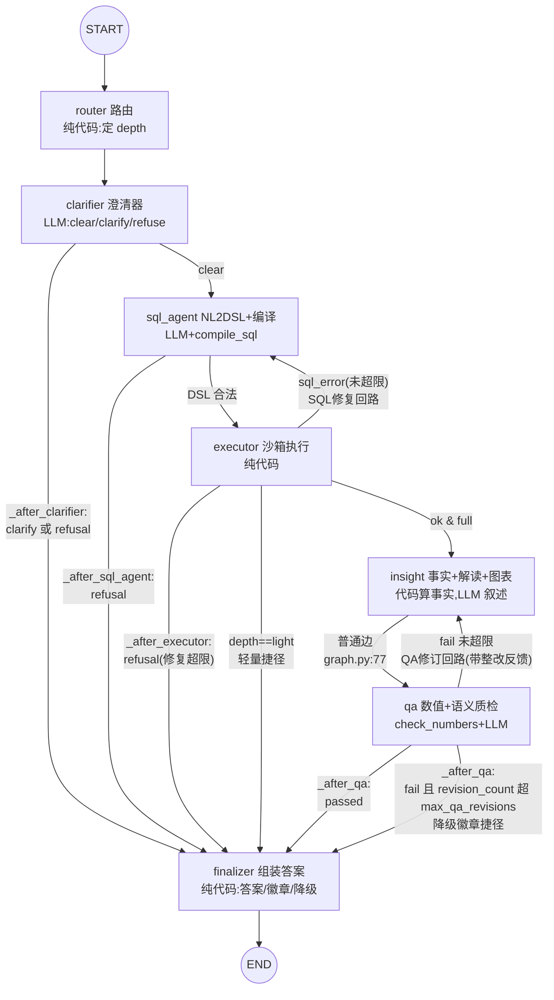

# L4 · graph.py 状态机精读：七节点、两回路、两捷径的编排艺术

> 精读对象：`app/agents/graph.py`（约 102 行）+ `app/agents/nodes.py`（节点实现）+ `app/agents/state.py`（状态总线）。
> 配套练习：`askbi/practice/e3_minigraph/`（画状态机 + 用 LangGraph 重搭最小图）。
> 面试钩子（STUDY_GUIDE 7.2 Q1）："为什么多 Agent 不用一个循环？——失败域隔离、差异化重试、质检独立性。"

---

## 1. 全景：mermaid 状态图

graph.py 模块 docstring（graph.py:1-11）用 ASCII 画了拓扑；下图是等价的 mermaid（可直接渲染），**实线=普通边，虚线/带标签=条件边**：



回路与捷径清点（面试要能徒手画出）：
- **SQL 修复回路**：executor →（sql_error 且未超限）→ sql_agent，`_after_executor` graph.py:47-48；
- **QA 修订回路**：qa →（fail 且未超限）→ insight，`_after_qa` graph.py:59；
- **轻量捷径**：executor →（depth==light）→ finalizer，跳过下钻与叙述（graph.py:49-50）；
- **拒答/澄清捷径**：clarifier → finalizer、sql_agent → finalizer（refusal 时）——失败不必走完全程。

循环边界各有上限：SQL 修复由 `max_sql_repairs`（config.py:39，默认 2）在 **executor 节点内**判（nodes.py:243-244：`rc = repair_count + 1; over = rc > max_sql_repairs`，超限时把 `refusal` 置上、条件边看到 refusal 就去 finalizer）；QA 修订由 `max_qa_revisions`（config.py:40，默认 2）在**条件边**判（graph.py:57）。注意两个回路"计数与判超"的位置不同——前者在节点里判（因为要顺带设置 refusal 文案），后者在边上判（状态里已有 revision_count）。

---

## 2. supervisor 编排：这个图是谁在指挥

严格说 askbi 不是 "一个 supervisor Agent 调度一堆工具 Agent"，而是 **LangGraph 固定拓扑 + 条件边函数做路由**——路由逻辑是写死的纯函数（graph.py:32-59），不是 LLM 自由决定下一步。这正是 STUDY_GUIDE 4.5 "确定性/不确定性分层" 的结构化体现（nodes.py:1-7 注释）：

| 节点 | 类型 | 职责 | 关键行为（源码锚点） |
|---|---|---|---|
| `router`（route_node） | 纯代码 | 预算路由：判定 depth=light/full | 正则匹配归因/趋势/对比语义（nodes.py:75-77），**不用 LLM**——"规则优先，省一次 LLM 调用"（nodes.py:68 注释） |
| `clarifier`（clarifier_node） | LLM | 意图澄清/越界拒答 | 产出 verdict=clear/clarify/refuse（nodes.py:94-133）；解析失败**默认放行 clear**（nodes.py:108-109）——澄清器失效不应阻断主链路 |
| `sql_agent`（sql_agent_node） | LLM+编译器 | NL→DSL→SQL | RAG 取示例（nodes.py:142）；DSL 校验失败先区分"未知指标/维度/字段→拒答"与"其余→带错误重试一次"（nodes.py:181-201）；取值校验不过→拒答（nodes.py:203-210）；compile_sql 失败→拒答（nodes.py:212-218） |
| `executor`（executor_node） | 纯代码 | 沙箱执行 | 失败计 repair_count 并在超限时置 refusal（nodes.py:242-251）；**空结果规范化**：单列单行 NULL → rows=[]+note"可能为权限范围外或无符合条件的数据"（nodes.py:259-265） |
| `insight`（insight_node） | 代码算事实+LLM 叙述 | 归因下钻/简单事实 + 解读 + 图表 | 归因题且 depth=full 走 `drill_down`（nodes.py:287-290，实现在 analytics.py:58）；prompt 铁律禁止 LLM 产出事实外数字（nodes.py:301-306）；Vega-Lite 图表纯代码生成（nodes.py:333-346：month 维度→折线，其他→bar 取前 15 反转） |
| `qa`（qa_node） | check_numbers+LLM | 数值确定性核验+语义核验 | 见 L3；未通过设 revision_count/revision_feedback（nodes.py:455-457） |
| `finalizer`（finalizer_node） | 纯代码 | 组装 answer 三形态 | refusal→`kind:"refusal"`；clarify→`kind:"clarify"`；否则 answer+`data_badge`（nodes.py:464-496，badge 里 `degraded= bool(sql_error)`，nodes.py:489） |

**为什么这样分工**：LLM 只放在语义不确定的环节（理解问题、写意图、写叙述、判语义），所有"错了会出事故"的环节（路由、执行、数值核验、组装）是纯代码。每个 LLM 调用记 token（`_record_usage`，nodes.py:38-45，按 node 分桶进 state.usage），每个节点产出 trace 事件（`_event`，nodes.py:34-35）——前端流水线和评测报告都吃这两条数据流。

---

## 3. 条件边函数逐个精读（graph.py:32-59）

### `_after_clarifier`（graph.py:32-35）

```python
if state.get("clarify") or state.get("refusal"):
    return "finalizer"
return "sql_agent"
```

clarify 和 refuse 共用一条捷径：两者都是"不再继续查询"的终态素材，finalizer 会按 `state["clarify"]`/`state["refusal"]` 分别组装成 `kind:"clarify"` / `kind:"refusal"`（nodes.py:465-468）。

### `_after_executor`（graph.py:44-51）——最忙的条件边

```python
if state.get("refusal"):          # 修复超限
    return "finalizer"
if state.get("sql_error"):
    return "sql_agent"            # SQL 修复循环
if state.get("depth") == "light":  # 预算路由：轻量链路跳过下钻与叙述
    return "finalizer"
return "insight"
```

优先级顺序即语义：**先看失败（refusal 优先于 sql_error）**——修复超限时 executor 已把 sql_error 和 refusal 同时置上（nodes.py:246-249），必须先判 refusal 否则永远在修复回路里打转。再看轻量捷径。这个函数有三种去向，是"条件边=业务规则表"的最佳例证。

### `_after_qa`（graph.py:54-59）

```python
if state.get("qa_report", {}).get("passed", False):
    return "finalizer"
if state.get("revision_count", 0) > get_settings().max_qa_revisions:
    return "finalizer"            # 超限：带失败徽章出结果（降级而非报错）
return "insight"                  # QA 修订循环
```

第三种去向 finalizer 的分支值得停一下：**降级不是抛错**。qa_report（含 `passed:false` 和 issues）会原样进 `answer["qa"]`（nodes.py:484），前端展示失败徽章。宁可告诉用户"这个答案没通过质检、问题是 XYZ"，也不编一个看起来对的答案、也不 500。这是"失败降级矩阵"思想（sandbox.py docstring 提到 DESIGN.md）在编排层的落点。

---

## 4. 状态总线 `GraphState`（state.py:8-46）

TypedDict、`total=False`——所有节点读写同一张扁平字典，LangGraph 的 StateGraph 语义负责合并节点返回的 update（节点返回 dict，只写自己负责的键）。字段按生命周期分组（state.py 注释）：输入（question/role/depth）→ 澄清 → DSL/SQL → 结果 → 归因与叙述 → 质检 → 输出 → 簿记（status/events/usage）。

两个隐蔽但重要的设计：
- `events` 每个节点是**追加**而非覆盖：`_merge_events(state, ...)`（nodes.py:48-49）把旧 events 带回来再拼新的——因为 LangGraph 默认对非 reducer 字段做整体替换，节点必须显式带回旧值。
- `usage` 同理是"读旧+加新"（`_record_usage`，nodes.py:38-45）。

---

## 5. 消融实验对应的开关位置（STUDY_GUIDE 第 5 节实验 2/3）

| 消融 | 开关位置 | 机制 | 量化效果 |
|---|---|---|---|
| `sloppy`（模拟 LLM 编数字） | `app/llm/mock.py:266` 模块级 `SLOPPY = False`；`_insight` 内 mock.py:275-277 失真注入 | runner.py:61-63 在评测启动时置 True，结束 runner.py:113 复位；单测里 tests/test_graph.py:48-56 直接置/复位 | QA 必须打回：`qa.passed is False`、`revision_count >= 1` |
| `no_qa`（关闭质检修订） | `settings.max_qa_revisions`（config.py:40）被 runner.py:66-67 临时置 0 | 条件边 `_after_qa` graph.py:57 读到 `0 > 0` 为 False？——注意方向：`revision_count(≥1) > 0` 为 True，首次失败即去 finalizer 降级 | 评测准确率 93.9% vs 100%，掉的两条即归因叙述题 |
| 轻量链路（对比用，不是消融） | `route_node` 的正则（nodes.py:75-77） | depth=light 时 executor 直接 finalizer（graph.py:49-50） | tests/test_graph.py:59-68 断言 light 不含 insight 调用、full 含 |

顺带：`run_ask`（graph.py:93-101）用 `astream(stream_mode="values")` 跑完整图取最终 state——API 的 SSE 流式（api/main.py）则逐 chunk 推送，评测与脚本共用 run_ask 保持行为一致。

---

## 6. 常见错误实现对比

| 错误写法 | 后果 | 正确做法（源码位置） |
|---|---|---|
| 用一个带工具的 LLM Agent 循环调"查询工具" | 路由/重试/质检全靠模型自觉，失败域不隔离、token 不可预算、QA 无法独立 | 固定拓扑+条件边（graph.py:62-80） |
| 修复/修订回路不设上限 | LLM 持续失败时死循环烧钱 | max_sql_repairs/max_qa_revisions（config.py:39-40）+ 超限降级（nodes.py:243-251、graph.py:57-58） |
| 超限后抛异常 | 用户拿到 500 而不是"部分可信结果" | 带 qa_report/失败徽章的 answer 降级输出（graph.py:58 注释、nodes.py:484-490） |
| 路由也用 LLM 判 | 每问多一次调用、p95 变长，且路由本身可能幻觉 | route_node 纯正则（nodes.py:73-88） |
| 节点返回不带回旧 events/usage | LangGraph 整体替换语义下，先前节点的事件被抹掉 | `_merge_events`/`_record_usage` 读旧加新（nodes.py:38-49） |
| executor 空结果直接返回 NULL 行 | 用户看到一行 None，误以为"数值就是 null" | 规范化为空集+原因说明（nodes.py:259-265） |

---

## 7. 面试讲法

**30 秒版**：
> 图上有七个节点、两条回路、两条捷径：router 纯规则先定预算档位，clarifier 澄清或拒答走捷径到 finalizer；sql_agent 把 NL 变 DSL、编译器变 SQL，executor 进只读沙箱执行，失败走 SQL 修复回路、上限 max_sql_repairs；轻量问题从 executor 直接出结果，归因问题进 insight 下钻+叙述，QA 做确定性数值核验，不过关带着整改反馈打回 insight，超过 max_qa_revisions 就带失败徽章降级输出。所有条件边都是纯函数——决策可解释、token 可预算。

**3 分钟版**：
- 第一分钟：画图（照第 1 节 mermaid 徒手画），强调每条条件边的**判定信号**是 state 里的量化字段（clarify/refusal、sql_error、depth、qa_report.passed、revision_count），"不是模型自由发挥"（graph.py:17-18 注释）。
- 第二分钟：讲两个回路的边界设计差异（executor 节点内计数+置 refusal vs qa 条件边读 revision_count），以及为什么降级优于报错（政策/数据问答的产品语义）。
- 第三分钟：讲确定性/不确定性分层（nodes.py:1-7 的表）+ 消融证据：删掉 QA 回路 93.9%，SLOPPY 注入被拦——"我系统里每个组件，都有被删掉也能量出损失的证明"（STUDY_GUIDE 7.4）。最后补一句证据链：tests/test_graph.py 八条端到端测试覆盖查询/归因/澄清/拒答/权限/QA 修订/轻量路由。

---

## 8. 自测五题（答案见文末折叠区）

1. `_after_executor` 里为什么必须**先**判 `refusal` 再判 `sql_error`？交换会怎样？
2. SQL 修复回路的超限判定在 executor 节点内，QA 修订回路的超限判定在条件边上——两种 placement 各自的原因是什么？
3. 轻量链路（light）跳过了哪些节点？对一条简单聚合题，LLM 调用次数从几次降到几次？
4. `clarifier_node` 的 JSON 解析失败时默认 verdict 是什么？这个默认值背后的产品权衡是什么？
5. `--ablation no_qa` 把 `max_qa_revisions` 置 0 后，一次失败的 QA 会在条件边走哪个分支？用户最终看到的答案和正常链路有何区别？

<details>
<summary><strong>答案（先自己答再看）</strong></summary>

1. 修复超限时 executor 把 `sql_error` 和 `refusal` **同时**置上（nodes.py:243-249）。若先判 sql_error，会永远回到 sql_agent——refusal（终止信号）被 sql_error（继续信号）屏蔽，回路失去边界。先判 refusal 保证"终止信号优先于继续信号"。
2. executor 内判：因为修复计数（repair_count）的递增和"超限时顺带生成给用户的 refusal 文案"是同一处逻辑（nodes.py:243-249），节点内做最自然；qa 边判：qa_node 已经维护了 revision_count（nodes.py:456），条件边只需读数比较（graph.py:57），无需节点内再放分支——两种 placement 都是"计数、判超、文案"三件事的最短路径。
3. 跳过 insight（归因下钻+LLM 叙述）和 qa。简单聚合题：light 下 LLM 调用 = clarifier + sql_agent = 2 次；full 下还要 insight + qa = 4 次（tests/test_graph.py:59-68 验证 light 的 usage 里没有 insight）。
4. 默认 `{"verdict": "clear", "reason": "解析失败默认放行"}`（nodes.py:108-109）。权衡：澄清器是"过滤器"，它失效时的错误方向应该是**放行**而不是拦截——把能答的问题错拦成"请澄清"伤害主链路可用性；误放的下游还有 sql_agent 的拒答、取值校验、QA 多层兜底。反之 sql_agent 的 DSL 解析失败默认是**报错/拒答**方向——因为它的输出要直接变成 SQL，宁可不答。
5. 走 `revision_count(=1) > max_qa_revisions(=0)` → finalizer（graph.py:57-58）。用户看到的 kind 仍是 answer，但 `answer["qa"]["passed"]=false`、带 deterministic/llm issues——即"带失败徽章降级输出"；正常链路则会先打回 insight 重写一次，多数能修成 passed=true。no_qa 消融掉的就是这次打回机会，掉的分即修订闭环的贡献。
</details>
